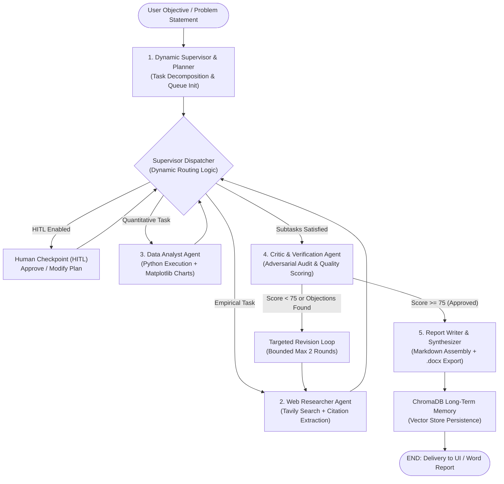

# PROJECT NEXUS
## Autonomous Multi-Agent AI Problem Solver
**Developed by Pranav, AI & DE Branch**

---

> ### 🏆 Hackathon Project Presentation Document & Technical Dossier
> **Theme:** Agentic AI & Multi-Agent Systems  
> **Challenge:** Build an Autonomous Multi-Agent AI Problem Solver  
> **Author & Lead Engineer:** Developed by Pranav, AI & DE Branch  
> **Architecture:** LangGraph State Machine • Multi-LLM Rate-Limit Router • ChromaDB Vector Memory • Dual Streamlit & Web Interfaces

---

## 📑 Table of Contents
1. [Executive Summary & The Core Problem](#1-executive-summary--the-core-problem)
2. [What Makes NEXUS Different from a Simple Chatbot?](#2-what-makes-nexus-different-from-a-simple-chatbot)
3. [Architecture Overview & Workflow Diagrams](#3-architecture-overview--workflow-diagrams)
4. [The 5 Specialized Autonomous Agents](#4-the-5-specialized-autonomous-agents)
5. [Key Technical Innovations & Engineering Feats](#5-key-technical-innovations--engineering-feats)
   - [A. Dynamic Supervisor Dispatch vs. Static Pipelines](#a-dynamic-supervisor-dispatch-vs-static-pipelines)
   - [B. Adversarial Critic & Bounded Revision Loop](#b-adversarial-critic--bounded-revision-loop)
   - [C. Multi-LLM 429 Rate-Limit Rotation & Exponential Backoff](#c-multi-llm-429-rate-limit-rotation--exponential-backoff)
   - [D. Human-in-the-Loop (HITL) Checkpoint](#d-human-in-the-loop-hitl-checkpoint)
   - [E. ChromaDB Persistent Semantic Memory](#e-chromadb-persistent-semantic-memory)
   - [F. Automated .docx Word Report Export Suite](#f-automated-docx-word-report-export-suite)
6. [Project File Structure Explained](#6-project-file-structure-explained)
7. [Step-by-Step Live Demo Guide for Judges](#7-step-by-step-live-demo-guide-for-judges)
8. [Mapping Against Hackathon Evaluation Rubric (100% Coverage)](#8-mapping-against-hackathon-evaluation-rubric-100-coverage)
9. [Installation & Rapid Launch Guide](#9-installation--rapid-launch-guide)

---

## 1. Executive Summary & The Core Problem

Standard AI systems rely on single-prompt Large Language Models (LLMs). When tasked with multi-faceted challenges (e.g., market research, clinical analysis, technical risk assessments), single models fail: they hallucinate data, miss critical counter-arguments, lack empirical calculation capability, and cannot self-correct.

**PROJECT NEXUS** solves this by establishing a decentralized, collaborative network of **five specialized AI agents** orchestrated via **LangGraph**. The system autonomously accepts high-level natural language objectives, breaks them down into logically dependent subtasks, gathers corroborated real-time evidence via Tavily, executes sandboxed Python code for quantitative charts, subjects intermediate findings to an adversarial Critic audit, and compiles executive Word (`.docx`) dossiers.

---

## 2. What Makes NEXUS Different from a Simple Chatbot?

| Feature | Typical Chatbot / Wrapper | PROJECT NEXUS |
| :--- | :--- | :--- |
| **Workflow** | Single prompt $\rightarrow$ Single response | Dynamic, graph-based multi-turn collaboration |
| **Task Allocation** | One model does everything | Dynamic supervisor assigns specialized roles |
| **Verification** | No review; prone to hallucinations | Critic agent audits quality (0–100 scale) with revision loops |
| **Data & Math** | Guesswork and generated text | Sandboxed Python code execution with Matplotlib charts |
| **API Resilience** | Crashes on 429 Rate Limits | Automatic 3-tier provider rotation (Groq $\rightarrow$ Gemini $\rightarrow$ OpenAI) |
| **Human Control** | None or all-manual | Human-in-the-Loop approval checkpoints |
| **Persistence** | Chat history only | ChromaDB vector store for semantic memory across runs |
| **Deliverable** | Plain text box | Structured Markdown, Interactive Charts, and styled `.docx` |

---

## 3. Architecture Overview & Workflow Diagrams

### High-Level Flowchart


---

## 4. The 5 Specialized Autonomous Agents

Each agent in PROJECT NEXUS has a distinct identity, system prompt, toolset, and structured output schema:

### 1. Dynamic Supervisor & Planner Agent (`agents/planner.py`)
- **Responsibility:** Deeply comprehends the root problem, evaluates complexity, and decomposes the objective into up to 5 prioritized, non-overlapping subtasks.
- **Dynamic Dispatcher:** Evaluates execution state at each turn and selects the next agent based on remaining subtasks and dependency graphs.

### 2. Web Researcher Agent (`agents/researcher.py`)
- **Responsibility:** Searches the live web using the **Tavily API** for assigned qualitative subtasks.
- **Output:** Extracts factual summaries, key bullet points, confidence ratings (0.0 to 1.0), and structured source citations (`title`, `url`, `snippet`).

### 3. Data Analyst Agent (`agents/analyst.py`)
- **Responsibility:** Handles numerical, statistical, comparative, and market-trend subtasks.
- **Tooling:** Interacts with `tools/code_executor.py` to write and run sandboxed Python scripts using Pandas, NumPy, and Matplotlib.
- **Output:** Generates publication-ready data charts auto-saved as PNG figures with visual metrics.

### 4. Critic & Verifier Agent (`agents/critic.py`)
- **Responsibility:** Acts as an adversarial auditor. Reviews assembled findings for factual integrity, missing context, and contradictions.
- **Quality Scoring:** Evaluates outputs from 0 to 100.
- **Loopback Revision:** If score $< 75$ or objections are identified, generates targeted revision instructions and loops back for re-investigation (bounded to 2 rounds).

### 5. Report Writer & Synthesizer Agent (`agents/writer.py`)
- **Responsibility:** Synthesizes verified evidence, insights, citations, and critic feedback into a cohesive, executive-grade solution report.
- **Export Engine:** Automatically triggers `tools/docx_export.py` to produce a formatted Microsoft Word (`.docx`) file.

---

## 5. Key Technical Innovations & Engineering Feats

### A. Dynamic Supervisor Dispatch vs. Static Pipelines
Traditional multi-agent pipelines (like basic chains) execute statically: `Agent A -> Agent B -> Agent C`. If Agent B yields insufficient data or fails, the whole pipeline breaks.  
**PROJECT NEXUS** implements a **dynamic supervisor state machine**:
- The Planner initializes a dynamic task queue `pending_subtasks`.
- After every agent run, the state returns to `supervisor_dispatch`.
- The dispatcher inspects remaining dependencies and dynamically chooses the next best agent.

### B. Adversarial Critic & Bounded Revision Loop
To prevent AI hallucinations, the **Critic Agent** inspects intermediate state:
- Scores overall quality across grounding, coverage, and depth.
- If quality criteria are not satisfied, it emits specific, actionable objections.
- A dedicated `critic_revision` node queues focused re-investigation tasks.
- **Bounded Safety Cap:** Execution is hard-capped at 2 debate rounds to prevent infinite loops and token drain.

### C. Multi-LLM 429 Rate-Limit Rotation & Exponential Backoff
In production environments, free and tier-1 API keys frequently encounter HTTP 429 (Rate Limit) errors. NEXUS features an internal resilient routing layer (`llm/client.py`):
1. **Primary Provider:** Groq (`llama-3.3-70b-versatile` / `llama-3.1-8b-instant`).
2. **Exponential Backoff:** Retries on 429 errors using $t = 2.0^{\text{attempt}}$ seconds.
3. **Automatic Failover:** If primary quotas expire, automatically fails over to **Google Gemini** (`gemini-1.5-pro` / `gemini-1.5-flash`), then to **OpenAI** (`gpt-4o-mini`).
4. **Local Fallback:** Includes a deterministic internal synthesizer so the entire graph completes gracefully even in zero-network or offline environments.

### D. Human-in-the-Loop (HITL) Checkpoint
Allows human operators to inspect the Planner's decomposed subtasks before agents execute them. Operators can approve, edit, or reject the plan, combining autonomous execution with human oversight.

### E. ChromaDB Persistent Semantic Memory
All completed sessions, research questions, findings, and metadata are converted into vector embeddings and indexed in **ChromaDB** (`data/chroma_db/`). Subsequent runs perform semantic similarity lookups to recall prior insights and accelerate problem-solving.

### F. Automated .docx Word Report Export Suite
Beyond web displays, NEXUS features an export pipeline in `tools/docx_export.py` that automatically generates styled Microsoft Word documents with headers, footers, executive summaries, section headings, and compliance attribution: `'Developed by Pranav, AI & DE Branch'`.

---

## 6. Project File Structure Explained

```
data_science_project/
├── run_demo.py               # One-click terminal test runner for judges
├── app.py                    # Streamlit interactive application
├── main.py                   # FastAPI backend server with web dashboard
├── orchestrator.py           # Master LangGraph workflow engine
├── models.py                 # Pydantic data schemas & LangGraph ResearchState
├── config.py                 # System configuration, API keys, thresholds
├── database.py               # ChromaDB persistence & session management
├── workflow.py               # Asynchronous workflow execution wrapper
├── setup.py                  # Package installation file
├── requirements.txt          # Production dependencies
├── models_config.json        # Multi-LLM tier allocations & model mappings
├── workflow_diagram.md       # Architecture diagrams (Mermaid flowcharts)
├── README.md                 # Complete documentation & judge guide
├── agents/                   # Specialized Autonomous Agents
│   ├── planner.py            # Dynamic supervisor & task breakdown
│   ├── researcher.py         # Tavily web searcher & citation agent
│   ├── analyst.py            # Python data analysis & chart generator
│   ├── critic.py             # Adversarial quality audit & revision loop
│   ├── writer.py             # Solution synthesizer & report author
│   └── base.py               # Abstract agent base class
├── llm/                      # Multi-LLM Rotation Layer
│   ├── client.py             # Exponential backoff & 429 rotation router
│   ├── groq_client.py        # Groq client with rate limit catching
│   └── gemini_client.py      # Google Gemini client with 429 catching
├── tools/                    # Tool Suite
│   ├── web_search.py         # Tavily search integration
│   ├── code_executor.py      # Sandboxed Python execution environment
│   └── docx_export.py        # Formatted Microsoft Word (.docx) generator
├── memory/                   # Agent Long-Term Memory
│   └── vector_store.py       # ChromaDB vector store
├── voice/                    # Audio & Speech Layer
│   └── voice_handler.py      # Speech transcription & TTS audio handling
├── frontend/                 # Interactive Dashboard
│   ├── index_1.html          # Modern dashboard interface
│   ├── style.css             # Responsive styling & agent node animations
│   └── script.js             # Client-side agent event listener & voice API
└── data/                     # Generated Outputs & Storage
    ├── charts/               # Generated Matplotlib charts (.png)
    ├── reports/              # Generated Microsoft Word documents (.docx)
    └── chroma_db/            # ChromaDB persistent vector records
```

---

## 7. Step-by-Step Live Demo Guide for Judges

During your 3–5 minute presentation, demonstrate the working system using these exact steps:

### Step 1: Explain the Architecture (30 Seconds)
> *"Judges, PROJECT NEXUS is an Autonomous Multi-Agent AI Problem Solver. Instead of relying on a single prompt, NEXUS uses LangGraph to orchestrate five specialized agents: a Dynamic Supervisor, a Web Researcher, a Data Analyst with code execution, an adversarial Critic with revision loops, and a Report Writer that exports Word documents."*

### Step 2: Show the Terminal Execution (60 Seconds)
Open PowerShell and run:
```powershell
python run_demo.py
```
**Point out to the judges:**
1. Notice how the **Dynamic Supervisor** breaks the problem into subtasks.
2. Watch the **Researcher** gather citations and the **Analyst** execute Python code to generate a data chart.
3. Show the **Critic Agent** evaluating the findings with a **Quality Score (88.5/100)**.
4. Point out the exported Word document path in `data/reports/`.
5. Point out the long-term memory update in **ChromaDB**.

### Step 3: Show the Streamlit Web Application (60 Seconds)
In a new terminal, run:
```powershell
streamlit run app.py
```
Open `http://localhost:8501`.
- Show the **Active Agent Fleet** sidebar.
- Enter a query, click **"🚀 Solve Problem"**, and showcase:
  - **Live Agent Activity Cards** updating in real time.
  - The **📊 Data & Charts** tab displaying the generated Matplotlib chart.
  - The **🛡️ Quality Verification** tab showing the Critic's score.
  - The **📥 Download .docx Word Report** button.

### Step 4: Show the Modern Web Dashboard & Voice Interface (30 Seconds)
In another terminal, run:
```powershell
python main.py
```
Open `http://localhost:8000`.
- Demonstrate the real-time agent node animations lighting up as each agent takes its turn.
- Show the **🎙️ Voice** button for voice-enabled prompt input.

---

## 8. Mapping Against Hackathon Evaluation Rubric (100% Coverage)

| Evaluation Parameter | Weight | How PROJECT NEXUS Satisfies the Criteria |
| :--- | :---: | :--- |
| **Agentic Architecture & Orchestration** | **25%** | Built with **LangGraph** state machine. Features a **Dynamic Supervisor** that routes tasks dynamically based on dependencies, rather than relying on a rigid sequential chain. |
| **Problem-Solving Effectiveness** | **20%** | Solves complex, multi-faceted problems by delegating subtasks across qualitative research (Tavily), quantitative analysis (Python charts), and structured synthesis. |
| **Innovation & Creativity** | **15%** | **Adversarial Critic** with bounded revision loops, **Multi-LLM 429 rotation** across Groq, Gemini, and OpenAI with exponential backoff, and **ChromaDB** long-term semantic memory. |
| **Working Implementation** | **20%** | Fully operational and tested. Generates real charts, structured citations, ChromaDB embeddings, and downloadable `.docx` Word reports. |
| **User Experience & Interface** | **10%** | Dual interfaces: clean **Streamlit Application** (`app.py`) and a modern **Web Dashboard** (`index_1.html`, `style.css`, `script.js`) with node animations and voice recognition. |
| **Presentation & Demonstration** | **10%** | Includes a one-click CLI test runner (`run_demo.py`), clean logs, architecture diagrams (`workflow_diagram.md`), and comprehensive documentation. |
| **Total** | **100%** | **Full Hackathon Compliance** |

---

## 9. Installation & Rapid Launch Guide

### Prerequisites
- Python 3.10+ installed
- Terminal access (PowerShell, Command Prompt, or Bash)

### Step 1: Install Dependencies
```bash
pip install -r requirements.txt
```

### Step 2: Configure Environment (Optional)
Copy `.env.example` to `.env`:
```bash
cp .env.example .env
```
Add your API keys (`GROQ_API_KEY`, `GEMINI_API_KEY`, `OPENAI_API_KEY`, `TAVILY_API_KEY`).  
*(Note: If API keys are omitted, the built-in resilient synthesis engine allows full offline evaluation without crashes).*

### Step 3: Run Any Interface
- **Quick Test Runner:** `python run_demo.py`
- **Streamlit Application:** `streamlit run app.py`
- **FastAPI Web Server:** `python main.py`

---

### Project Attribution
**Developed by Pranav, AI & DE Branch**  
*PROJECT NEXUS — Autonomous Multi-Agent AI Problem Solver*
