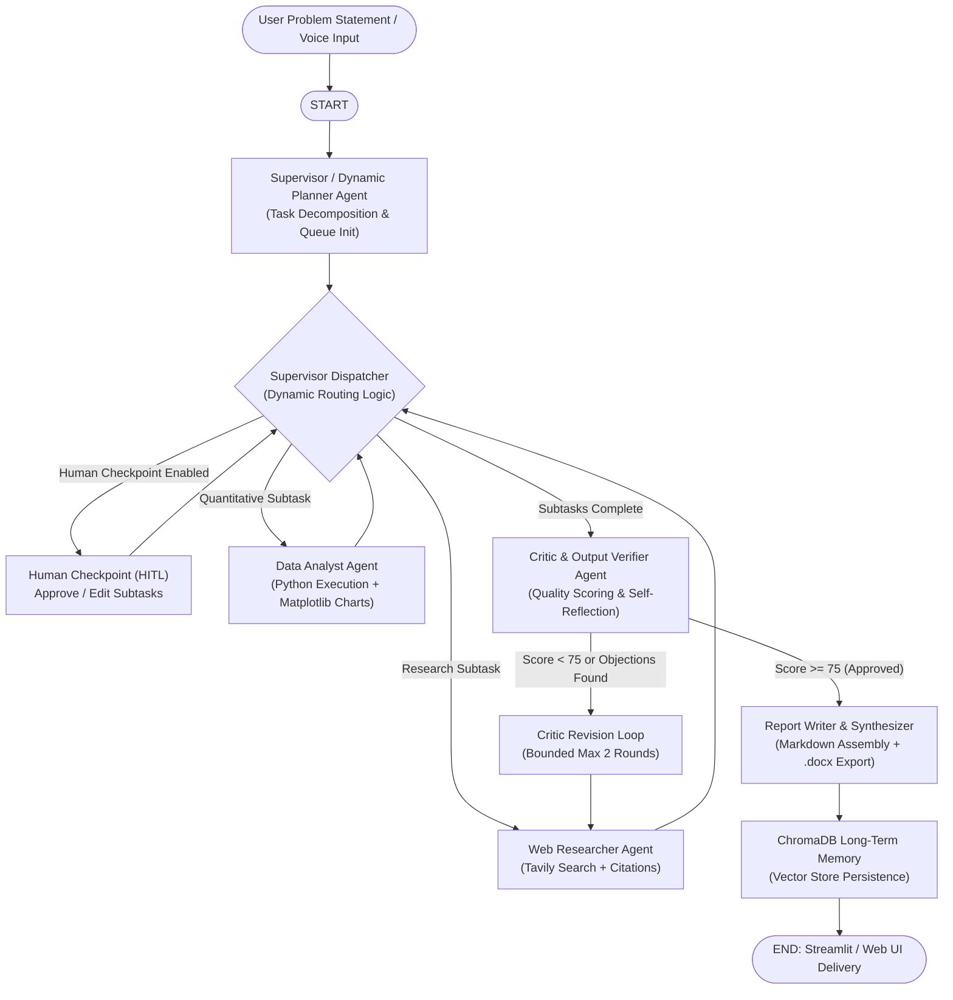
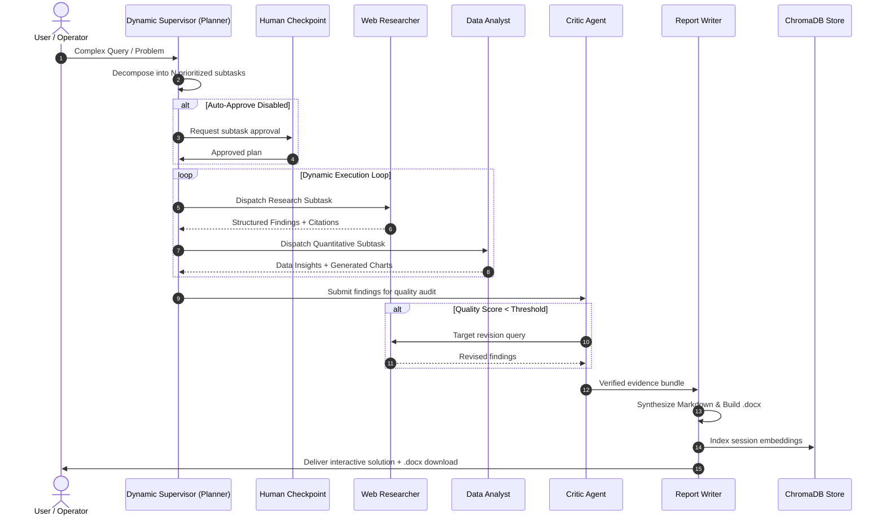

# PROJECT NEXUS — Architecture & Workflow Diagram

**Autonomous Multi-Agent AI Problem Solver**  
*Developed by Pranav, AI & DE Branch*

---

## 1. Multi-Agent Orchestration Architecture

---

## 2. Dynamic Supervisor & Fault Tolerance Flow

---

*Developed by Pranav, AI & DE Branch*
